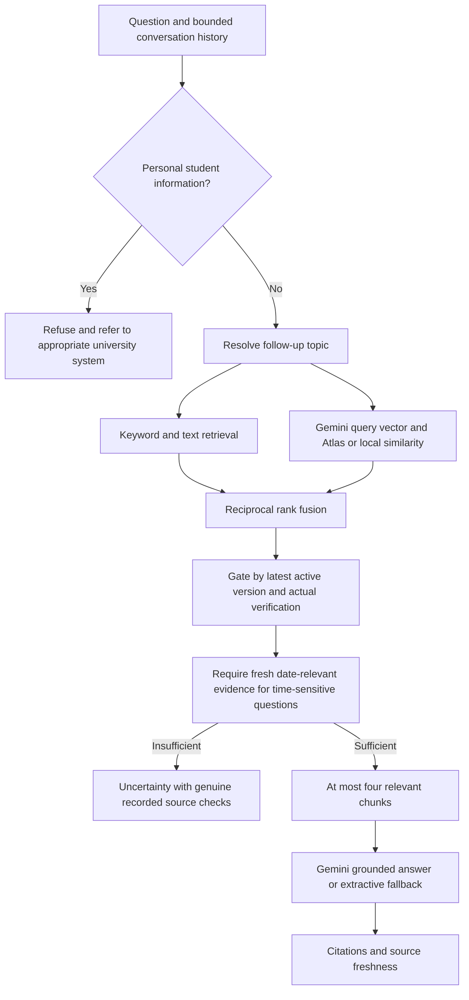

# TRAIL AI Desk: audit and implementation report

Date: October 4, 2026 (Asia/Manila). This work extends the existing capstone project. It preserves its screens, design, demo credentials, read-only demo fallback, scope policy, conversational history and original tests. Existing uncommitted user work was retained. No deployment, database credentials, real account, university memo or new official knowledge record was fabricated.

## 1. Current system audit

Before changes, the frontend used Expo 57, React Native 0.86, React 19.2 and Expo Router. The exact [Expo v57 documentation](https://docs.expo.dev/versions/v57.0.0/) was reviewed before code changes.

| Area | What existed | Finding |
| --- | --- | --- |
| Screens | Login, dashboard, AI desk, university information categories, local support ticket, starter Explore | Useful existing design preserved; support ticket intentionally remains a local demo |
| API | Node HTTP server; health, demo auth, chat, knowledge, offices, calendar | Small reusable API; no real auth or admin actions |
| Authentication | Hardcoded demo email/password, frontend boolean sign-in | No real user/password storage, sessions, roles, reset tokens or email; Forgot Password showed demo instructions |
| MongoDB | Reused driver connection; `knowledge` collection; category/keyword indexes; clearly labeled demo seeding | Query failure permanently disabled the connection and switched to demo |
| Knowledge | Full-text legacy records with title, category, office, content, source, keywords and update label | Review required explicit `dataStatus` and valid `verifiedAt`/`verifiedBy`; no source versions, chunks, fetch history or uploads |
| RAG | Normalized keyword scoring; at most three full records; pronoun follow-up context | Lexical only; no embeddings or vector search |
| AI | Optional OpenAI chat-completions adapter | Intended Gemini integration did not exist |
| Citations | Source/title/office/update/demo status | No URL/document actions, genuine check timestamps or freshness indicators |
| Frontend data | Independent bundled demo records | Information screen always used demo data, even with an API configured |
| Configuration | Expo public API URL; MongoDB and optional OpenAI variables | No reset-email, refresh or vector settings; no lint configuration |
| Tests | 13 Node test cases, including demo RAG, refusals, follow-up, validation, DB fallback, AI failure and network failure | All 13 and TypeScript passed before edits |

Other issues found: wildcard API CORS, no request rate limiting, a missing adaptive-icon background referenced in `app.json`, no protected frontend routes, and a hardcoded dashboard name. Starter components/assets were retained because removing them was unnecessary.

## 2. Features implemented

- MongoDB-backed real account login, hashed bearer sessions, password reset, logout and admin authorization alongside explicit demo access.
- Admin knowledge management: approved URLs, PDF/text uploads, office information, metadata editing/search, explicit review, unverify, archive, manual refresh, status/errors and version history.
- Source metadata and versioned documents/chunks, with pointer-based activation and preserved prior versions.
- Gemini REST generation and embeddings; hybrid keyword/vector retrieval, relevance ranking and source citations.
- Scheduled official URL rechecks, content hashing, unchanged-content embedding avoidance and visible failed/overdue checks.
- Conservative announcement responses with real recorded checks, Manila dates and explicit coverage limits.
- Student citations for uploaded memoranda without fabricated URLs; verified documents can be downloaded safely.
- API-backed information browsing, protected routes, memory-only sessions, loading/error/validation states and retained demo UI. Sources with no category default to the existing University information section.
- Additional source/auth/integration tests, ESLint configuration, environment examples, setup instructions and Atlas index definition.

## 3. Important files modified or added

| File(s) | Change |
| --- | --- |
| `server/src/app.mjs` | Existing API extended with real auth/admin/document routes, bounded validation, CORS/security headers, rate limiting, verified retrieval and safe announcement handling |
| `server/src/server.mjs`, `server/src/config.mjs` | Source refresh worker, configuration validation and graceful shutdown |
| `server/src/auth/service.mjs` | Login/session checking, generic reset requests, atomic reset flow, role checks and logout |
| `server/src/auth/store.mjs` | Mongo user/session operations, indexes and single-document reset consumption |
| `server/src/auth/password.mjs` | Salted scrypt hashing, fixed KDF parameters, timing-safe verification and password validation |
| `server/src/auth/email.mjs` | Configured Resend REST delivery and controlled reset-link origins |
| `server/src/auth/provision.mjs` | Explicit trusted-terminal user/admin provisioning with hidden password input |
| `server/src/knowledge.mjs` | Extended optional metadata, actual verification status, freshness, document view paths and legacy compatibility |
| `server/src/db/mongo.mjs` | Source/version/chunk/auth indexes; existing connection and demo seeding preserved |
| `server/src/db/knowledge-store.mjs` | Mongo ingestion/admin/version operations, latest verified chunk gating, hybrid ranking, failed-write handling and batch metadata loading |
| `server/src/ingestion/safe-fetch.mjs` | University allowlist, public DNS validation, connection pinning, redirect checks, byte caps and timeout |
| `server/src/ingestion/extract.mjs` | PDF/HTML/text extraction, cleaned plain text, chunks, SHA-256 and bounded upload validation |
| `server/src/ingestion/refresh.mjs` | Changed/unchanged/failed refresh pipeline and nonoverlapping scheduler |
| `server/src/rag/retrieval.mjs`, `server/src/rag/freshness.mjs` | Existing retrieval helpers retained; privacy boundary, bounded evidence context, temporal relevance and uncertainty handling |
| `server/src/ai/generate.mjs`, `server/src/ai/embeddings.mjs` | Gemini priority, legacy provider compatibility, structured citations, URL checks, batched embeddings and query-vector cache |
| `server/src/security/rate-limit.mjs` | Bounded in-process general/chat/auth request limits |
| `src/app/index.tsx`, `_layout.tsx`, `dashboard.tsx` | Real/demo login selection, protected routing, expiry/logout, real session identity and admin navigation |
| `src/app/forgot-password.tsx`, `reset-password.tsx` | Complete request/reset forms, link token, password confirmation, loading and success/errors |
| `src/app/admin.tsx` | Simple authorized source management interface with explicit version/revision-bound approval |
| `src/app/ai-desk.tsx`, `information.tsx` | Extended provenance, actual source-check display and real knowledge browsing |
| `src/components/source-card.tsx`, `desk-form.tsx` | Reusable metadata citations, safe view actions and shared form styling |
| `src/services/auth.ts`, `api.ts`, `knowledge.ts` | Memory session, bounded HTTP requests, cancellation, auth and admin contracts |
| `src/services/chat.ts`, `chat-api.mjs`, `chat-api.d.mts`, `src/data/demo-knowledge.ts` | Existing chat retained, extended source types/timeout and honest offline temporal/privacy behavior |
| `src/hooks/use-color-scheme.web.ts`, `app.json` | Hydration lint fix and removal of the missing icon-background reference |
| `server/test/auth.test.mjs`, `knowledge.test.mjs`, `verified-rag.test.mjs`, `test/helpers/`, `test/run.mjs` | Security, refresh, ingestion, RAG and HTTP integration tests; all original tests preserved |
| Root/server `package.json` and lockfiles; `eslint.config.js` | Required parsing/upload/lint tooling, commands and scoped UUID security patch |
| `.env.example`, `server/.env.example`, `.gitignore`, `README.md`, `docs/` | Nonsecret configuration, setup/report/index/audit artifacts |

`ticket.tsx` remains the existing local demo: it does not create a real university support ticket. Legacy sample knowledge was preserved rather than replaced with invented official information.

## 4. Database changes

| Collection | Purpose / fields | Indexes |
| --- | --- | --- |
| `knowledge` | Existing records retained; original clearly labeled demo seeding remains | Existing category/active and keywords; additional verified-state/active index |
| `knowledge_sources` | Source identity and optional provenance, verification, current-version pointer, version/revision, content hash, real check/attempt timestamps, due time, refresh error/status | Active/status/type/nextCheck; category/active; sparse URL |
| `knowledge_versions` | Version content, hash, timestamps, source ID, review snapshot, active/archive bookkeeping; bounded uploaded original bytes | Unique source/version |
| `knowledge_chunks` | Chunk text/order/offsets, source/version IDs, title/category/keywords, optional vectors and embedding model | Unique version/order; source/version; weighted text index; embedding model |
| `users` | Explicit user ID/email/name/role, scrypt password hash, active state, credential version; hashed reset token and expiry/request timestamp | Unique ID/email; sparse unique reset-token hash |
| `authSessions` | SHA-256 token hash, user ID, credential version and expiry | Unique token hash; user ID; expiry TTL |

Source types: `official_webpage`, `official_pdf`, `uploaded_document`, `office_verified_information`. States: `verified`, `pending_verification`, `outdated`, `archived`, `unavailable`. Optional fields include `sourceUrl`, `documentTitle`, `documentNumber`, `issuingOffice`, `dateIssued`, `datePublished`, `lastChecked`, `lastUpdated`, `nextCheck`, `isActive`, `version`, `contentHash` and effective-date ranges.

TTL applies **only to expired sessions**, never university knowledge or user documents. Token expiry is checked explicitly even before TTL cleanup runs.

There is no destructive automatic migration. Reviewed legacy records remain readable; legacy full records are lexical and must be re-ingested to receive modern chunks/vectors and admin editing. New managed sources require actual admin review. The [Atlas index definition](atlas-vector-index.json) must be created manually on `knowledge_chunks`; dimensions must match the configured embedding model. [MongoDB vector search documentation](https://www.mongodb.com/docs/manual/reference/operator/aggregation/vectorsearch/) describes the managed stage.

## 5. Final RAG architecture

Keyword and vector results are combined by reciprocal rank fusion. Searches prefilter active version IDs, and Atlas results are checked against the current source pointer afterward, preventing stale archived or pending chunks from entering evidence or crowding out candidates. Local prototype vector comparison is bounded to 1,500 chunks; source/legacy reads are also bounded. It is suitable for a capstone corpus, not an unbounded collection.

Gemini receives only selected chunks plus a short history. Prompts treat documents/history as untrusted data and disallow unsupported university claims, URLs and inferred negative announcements. Gemini uses structured JSON citations; invalid citation numbers and URLs absent from evidence are rejected. With no provider key, cited extracted text is returned. Provider failure returns a bounded error with retrieved provenance. The original OpenAI adapter remains usable for prior configurations; Gemini takes precedence. Generation defaults to `gemini-3.5-flash-lite`, following [current Google guidance for new projects](https://ai.google.dev/gemini-api/docs/models); Gemini 2.5 access is limited to existing users. Embeddings default to the supported `gemini-embedding-001` with 768 dimensions. These controls reduce hallucination risk; live answer quality still needs evaluation with reviewed university material. [Gemini API reference](https://ai.google.dev/api/generate-content).

## 6. Source update architecture

The running backend polls approved sources due for review. Default content refresh interval: 24 hours; default due-source poll: 60 seconds. The interval is configurable; the scheduler checks only verified active official URL sources.

1. Validate the approved HTTPS domain, DNS addresses and redirects; pin the connection to a validated public address.
2. Fetch bounded content and extract plain text. Only added pages/PDF URLs are checked; linked resources are not automatically crawled.
3. Compare cleaned-content SHA-256. If unchanged, record the genuine check timestamp and next due time; do not regenerate vectors.
4. If changed, prepare chunks/vectors, store a new version, then atomically swap the source pointer with a version/revision guard. Older versions remain archived.
5. Failed checks retain previous verified content and successful-check time; record the failed attempt/error separately. Failed or overdue checks are visible.

Approved URL refreshes inherit the source's original human approval and record `verificationMethod=official_url_refresh` with an actual content-check timestamp. They do not pretend the administrator manually reread the new version. Initial uploads/office text and provenance edits require explicit `admin_review` verification.

Readers use the source pointer as authority. Version/archive markers are secondary bookkeeping. Staged data is retained if a write acknowledgement is lost, so a potentially committed version is not accidentally deleted. Production should reconcile interrupted staging/bookkeeping and use a shared worker lease for multiple replicas.

Temporal answers require fresh evidence referring to the requested date, with Manila `today`/`tomorrow` handling and optional effective-date ranges. General keyword matches are insufficient. No match leads to a conservative answer and only genuine successful URL checks; absent check timestamps remain absent. A recorded check of a few pages is not a complete search of all official channels.

## 7. Forgot Password flow

Real login → Forgot Password → validated registered email → generic acceptance → bounded background provider send → configured reset link → new 12–128 character password plus confirmation → atomic reset token consumption/password replacement → login.

Passwords use salted scrypt (`N=32768`, `r=8`, `p=3`) with timing-safe comparison. Tokens contain 32 cryptographically random bytes and are stored only as SHA-256 hashes. Reset expiry defaults to 15 minutes. A single Mongo document update consumes the token, saves the password hash and increments the credential version; concurrent reuse fails and older bearer sessions become invalid. Sessions default to 12 hours and are checked server-side on each authorized action.

No account existence is disclosed by reset responses. Missing provider/sender/reset URL returns the same configuration error for all accounts. Provider rejection clears its token and never claims delivery; accepted jobs say only that instructions may arrive if an account exists and delivery succeeds. Per-account cooldown and IP limits restrict repeated requests. [OWASP password reset guidance](https://cheatsheetseries.owasp.org/cheatsheets/Forgot_Password_Cheat_Sheet.html).

The reset queue and request counters are process-local. A restarted process may lose pending email jobs; production hosting should supply durable jobs and shared rate limits. Tokens stay in client memory; closing/reloading requires sign-in. The demo account has no real reset workflow.

## 8. Packages/tools and recommendations

Already present: Expo/React Native/Router/UI modules, React, TypeScript and the MongoDB native driver. Existing native UI, Router and driver conventions were reused.

| Newly installed / changed | Category | Why necessary / equivalent check |
| --- | --- | --- |
| `cheerio` 1.2.0 | Required | Backend HTML extraction; no existing HTML parser. Parsed content is converted to text, not executed/rendered HTML. [Official documentation](https://cheerio.js.org/docs/basics/loading/) |
| `pdf-parse` 2.4.5 | Required | Actual PDF text extraction; no PDF parser previously. Parser cleanup and size limits are applied. [Maintainer documentation](https://github.com/mehmet-kozan/pdf-parse) |
| `expo-document-picker` ~57.0.3; `expo-file-system` ~57.0.7 | Required | Cross-platform PDF/text selection and native byte reading; installed through Expo's version-aware installer. [Expo v57 picker](https://docs.expo.dev/versions/v57.0.0/sdk/document-picker/), [file system](https://docs.expo.dev/versions/v57.0.0/sdk/filesystem/) |
| `eslint` 9.x; `eslint-config-expo` ~57.0.2 | Required for requested checks | Project lacked lint config/dependencies. Installed by Expo CLI; ESLint 9 lifecycle requires a later validated migration |
| Scoped `xcode → uuid@11.1.1` override | Security patch | Compatible CommonJS UUID patch; PBX parsing/generation/write round-trip verified. No Expo downgrade |

No auth, scheduler, validation, logging, cache, Gemini SDK or extra database package was necessary: Node crypto/fetch/timers, bounded field validation, static redacted logs, the existing Mongo driver and Node tests cover prototype needs. `bcrypt`/`argon2` would duplicate the implemented password KDF; `dotenv` duplicates Node's native env-file support; Express would replace a working small HTTP server without adding required behavior. No LangChain/LlamaIndex or Redis was installed.

| Recommendation not installed | Category | Problem addressed / existing equivalent / compatibility |
| --- | --- | --- |
| MongoDB Atlas Vector Search | Recommended | Managed vector performance as corpus grows; existing driver/stage integration and local cosine fallback exist. Create/configure the matching index |
| Resend service with verified sender | Required for live reset email | Provider exists in code via REST; no SDK is needed. Alternative providers can replace this small adapter. [Resend API](https://resend.com/docs/api-reference/emails/send-email) |
| External scheduler + durable job queue | Recommended for production | Survives process restarts and coordinates replicas; prototype has built-in periodic worker and bounded email jobs. Use hosting cron/queue first, avoid `node-cron` duplication |
| Shared rate limiting / Redis | Optional future | Coordinates multiple API instances and caches bounded work; existing in-process limits/query-vector cache suffice for one prototype server. Never cache stale negative announcements blindly |
| Pino + centralized logs | Recommended for production | Structured correlation/operational monitoring; prototype logs already omit credentials/tokens/body data. Add when deployed monitoring requires it |
| Zod | Optional future | Shared complex API schemas and inferred types; current endpoints already validate bounded fields. Useful if API surface expands |
| Playwright / React Native Testing Library | Recommended | Browser/device form/navigation tests beyond TypeScript/export. Existing Node integration tests cover HTTP services; no frontend automation was present |
| OCR and isolated parsing worker | Optional future | Scanned PDF reading and CPU/memory isolation for large documents; current parser handles text PDFs and rejects empty extraction |
| Upload malware scanner / object storage | Recommended for production | Larger original files and file inspection; prototype restricts PDF/text to 5 MiB and serves reviewed files as attachments |
| University SSO / MFA | Optional future | Real institutional identity and stronger administrative login; current opaque sessions/role checks are implemented, no SSO provider exists |
| ESLint 10 / Expo security updates | Recommended maintenance | Supported tooling and advisory remediation; validate Expo/plugin compatibility instead of forcing a major downgrade. [ESLint version support](https://eslint.org/version-support/) |

Node 24 was used; backend minimum is >=22.13. Installed parsers are compatible with the current runtime. Required tools cover retrieval/vector access, Mongo integration, parsing, extraction, scheduling, password security/email, validation, rate limiting, logging, testing, caching, timeouts, environment management and connection reuse without a broad package expansion.

## 9. Security and performance improvements

- Server-side bearer and admin-role checks protect every admin read/mutation; client guards supplement them. No client-provided role grants privileges.
- Version/revision-bound verification prevents approving content or metadata changed since the admin reviewed it. Metadata edits clear verification. Pending content and files are hidden from student endpoints.
- Uploaded originals are capped, MIME/signature/text checked, stored without executable paths, and served only for active verified sources with attachment, nosniff and sandbox headers.
- SSRF controls include trusted-domain boundaries, HTTPS, no URL credentials/custom ports/IP literals, public DNS validation, pinned addresses and checked redirects. [OWASP SSRF guidance](https://cheatsheetseries.owasp.org/cheatsheets/Server_Side_Request_Forgery_Prevention_Cheat_Sheet.html).
- Password/reset/session secrets are hashed; real server keys never use `EXPO_PUBLIC_` variables. Environment examples contain empty secret fields. Errors/logs avoid credential-bearing DB/provider messages.
- CORS uses configured origins. Authentication/chat/general requests are limited; body/question/history sizes and network operations are bounded.
- Database connections are reused and read failures can recover on later reads. Writes never pretend persistence through demo fallback.
- Reads batch source versions, avoiding one database round trip per source. Chunk size is 1,800 characters with 250-character overlap. Retrieval returns a bounded candidate set and at most four evidence chunks.
- Document embeddings use batches of 20, at most two requests concurrently, with an operation deadline. Repeated query vectors use a bounded 100-entry cache. Unchanged sources skip embedding work completely. Generated answers are not blindly cached across source changes.
- UI requests support cancellation/errors and separate longer ingestion timeouts; no automatic mutation retries create duplicate sources. Render-related lint findings were fixed.

Online npm audit initially found 30 frontend advisories. The compatible UUID override reduced this to **22 (19 high, 3 moderate)**. Remaining underlying advisories include [braces](https://github.com/advisories/GHSA-vfj7-8cjw-p6xm), [node-forge](https://github.com/advisories/GHSA-86w9-cpqp-85rv), and [decode-uri-component](https://github.com/advisories/GHSA-vcc3-ghjq-m6fr). The first two had no patched published version when checked; the patched decoder uses ESM and cannot be substituted into the current CommonJS consumer safely. `npm audit fix --force` proposes incompatible major downgrades, so it was not used.

The final backend dependency audit found **zero advisories**. Full machine-readable reports: [frontend](npm-audit-frontend.json) and [backend](npm-audit-backend.json). These findings are not a clean production security certification.

## 10. Test results

The final integrated suite passed **75/75 tests**: 13 original cases, 23 auth cases, 19 RAG/API/parser cases and 20 knowledge/refresh/security cases. No failures, skips or cancellations.

| Check | Result |
| --- | --- |
| `npm.cmd run test:backend` | PASS — 75 tests |
| `npm.cmd run typecheck` | PASS — TypeScript strict checks |
| `npm.cmd run lint` | PASS — Expo ESLint, no errors/warnings |
| `npm.cmd run export:web` | PASS — 11 static routes, web JS/CSS exported to `dist/trail-web` |
| `npx.cmd expo export --platform android --output-dir dist/trail-android` | PASS — Hermes bundle and assets exported; sandbox compiler launch needed permission retry |
| Node syntax checks for every backend `.mjs` | PASS |
| Xcode/UUID compatibility | PASS — CommonJS parse, 100 unique PBX IDs, write/reparse round trip |
| `git diff --check` | PASS — no whitespace errors |
| Online backend npm audit | PASS — zero advisories |
| Online frontend npm audit | FAIL security audit — 22 remaining advisories (19 high, 3 moderate) after compatible patch |

Initial parser/upload/lint installation required network permission after sandbox network errors; lint's first automatic setup attempt needed a rerun after installation. Initial Android export failed with sandbox `spawn EPERM`; the allowed retry passed. An intermediate HTTP review test failed before revision metadata was wired, then passed after the integration fix. These are resolved setup/integration failures, distinct from remaining dependency advisories. Export emitted only the host's `NO_COLOR`/`FORCE_COLOR` warning.

| Requested scenario | Coverage |
| --- | --- |
| Normal verified question; follow-up; unknown information | Verified RAG and preserved original RAG tests |
| Personal-information refusal | Original and extended third-person/follow-up tests |
| Official URL and uploaded memo retrieval | Source store plus HTTP ingestion/review/download integration |
| Outdated source | Excluded from real retrieval; stale general source warnings/temporal refusal |
| Refresh unchanged/changed/fetch failure | Check metadata, vector-call count, pointer/archive state and retained content |
| No official announcement found | No fabricated checks/URLs; coverage, failed checks and Manila date relevance |
| AI failure | Original provider failure and Gemini response/citation validation |
| MongoDB failure | Original/read fallback, authentication failure, write rejection and ambiguous activation acknowledgement |
| Invalid source | Dates, metadata boundaries, invalid PDFs/upload MIME/size/base64 |
| Login and forgot-password request | Unit + actual HTTP integration with configured test adapters |
| Expired/invalid/successful reset | Expiry, single use, concurrent consumption, session revocation and generic responses |
| Unauthorized admin access | Anonymous/demo/student rejection before reads and each mutation |
| Malicious/unapproved URL ingestion | Domain deception, IPs, private/reserved DNS, mapped IPv6, unsafe redirects and byte limits |

Tests use test-only in-memory Mongo/provider adapters, never production demo substitutes. The PDF test invokes the installed parser against real synthetic PDF bytes. Network failure tests exercise actual failed loopback requests. Live external services were not configured or called.

## 11. Remaining limitations

1. MongoDB must be configured for persisted knowledge, real accounts and reset tokens. No actual database contents were migrated or live Atlas query validated here.
2. Gemini needs an actual server key and available model names. Live answer quality/quotas require evaluation. Configure embeddings before ingestion; without them, sources remain lexical until re-ingested. Model/dimension changes require reindexing and matching Atlas settings.
3. Resend needs a key, verified sender and deployed reset URL. No live reset email/inbox delivery was claimed or tested.
4. Authorized personnel must provide and verify real official USTP URLs/documents. The included capstone samples remain DEMO / UNVERIFIED. There is no exhaustive crawler or social-media watcher.
5. Time handling supports exact dates, today/tomorrow and effective ranges; broader natural-language event windows are conservative. Checks cover listed pages only; absence never confirms an event outcome.
6. Text PDFs and UTF-8 text uploads are supported. DOCX/image/OCR and live native picker/device navigation are not validated. PDF parsing occurs in the API process and should be isolated for production.
7. The local semantic fallback is bounded, and legacy records are lexical. Large corpora need the managed vector index, pagination and background indexing.
8. Scheduler/email queues/rate limits/cache are process-local. Multiple replicas need durable queues/shared limits/leases, and interrupted staging needs reconciliation. Production hosting must keep refresh jobs running.
9. Client tokens are deliberately memory-only; reload requires login. Institutional SSO/MFA, durable secure token storage, email-change/account management and self-registration are outside this prototype scope.
10. Admin source review is necessary to keep personal records out of this general-public KB. No personal-record system is connected; deterministic question/prompt boundaries do not replace review of uploaded material.
11. 22 frontend dependency advisories remain, and Expo-selected ESLint 9 has reached end of support. Compatible framework/tooling updates need a separate validated maintenance change.
12. Web/Android exports validate bundles, not production deployment or installed-app behavior. Support tickets remain local demo-only. No hosting deployment or end-user email was performed.

## 12. Highest-priority next steps

1. Configure MongoDB and provision a real authorized admin using `npm.cmd run provision` in `server/`.
2. Set Gemini server credentials before importing sources; create the Atlas vector index if using Atlas.
3. Add a small set of real official USTP pages and general-public memoranda. Review titles, issuing offices, dates/effective ranges and extracted content; explicitly verify them.
4. Configure the actual email sender/provider and HTTPS reset screen, then test one end-to-end reset and confirm old-session revocation.
5. Run reviewed university question/answer and announcement evaluations, including absence, outdated pages and changed documents. Verify source coverage with offices.
6. Test the web forms and native PDF picker on actual devices. Deploy behind HTTPS with correct CORS origins and persistent refresh execution.
7. Resolve remaining framework advisories through compatible upstream releases; add production parser isolation, durable jobs, shared rate limiting and monitoring before broad public rollout.
